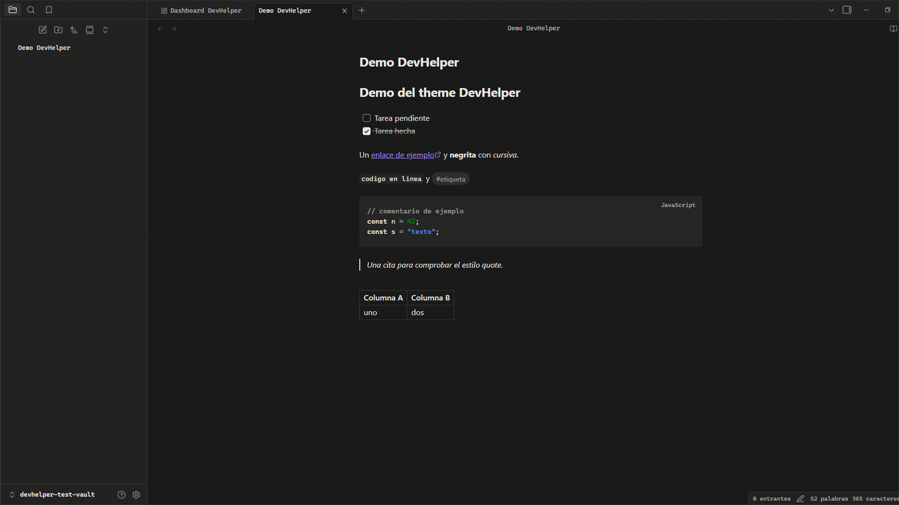

# DevHelper

[English](#english) · [Español](#español)



---

## English

A dark, monochrome theme for [Obsidian](https://obsidian.md), designed together
with the [DevHelper Dashboard](https://github.com/DidierPiracocaCampos/devhelper-obsidian)
plugin. Near-black background (`#171717`), high-contrast text (`#e8e8e8`,
14.6:1) and a few semantic accents: strings in blue, numbers in green,
everything else in greys. Rounded corners, soft shadows, a subtle noise texture
and mobile support with safe areas and 44 px touch targets.

> **Dark only.** In light mode Obsidian falls back to its base theme.

### Installation

- **Community themes** (once approved): *Settings → Appearance → Themes →
  Manage*, search for **DevHelper**.
- **Manual**: create `<vault>/.obsidian/themes/DevHelper/`, copy `theme.css`
  and `manifest.json` into it, then pick **DevHelper** in *Settings →
  Appearance* with the base color scheme set to **Dark**.

### Compatibility

`minAppVersion` 1.0.0 · no dependencies · no `!important` · no remote resources.

---

## Español

Theme oscuro y monocromo para [Obsidian](https://obsidian.md), diseñado junto
al plugin [DevHelper Dashboard](https://github.com/DidierPiracocaCampos/devhelper-obsidian).
Fondo casi negro (`#171717`), texto de alto contraste (`#e8e8e8`, ratio
14.6:1) y acentos semánticos puntuales: strings en azul, números en verde y
todo lo demás en grises. Esquinas redondeadas, sombras suaves, textura de ruido
sutil y adaptación a móvil con safe areas y objetivos táctiles de 44 px.

> **Solo modo oscuro.** En modo claro Obsidian usa su theme base.

### Instalación

- **Themes de la comunidad** (cuando se apruebe): *Ajustes → Apariencia →
  Themes → Gestionar*, busca **DevHelper**.
- **Manual**: crea `<vault>/.obsidian/themes/DevHelper/`, copia `theme.css` y
  `manifest.json` dentro y elige **DevHelper** en *Ajustes → Apariencia* con el
  modo base en **Oscuro**.

### Capturas

- `screenshot.png`: miniatura 16:9 (512×288) que usa la tienda.
- `screenshots/screenshot-editor.png`: editor con sidebar en escritorio.
- `screenshots/screenshot-mobile.png`: vista móvil.

### Desarrollo

```bash
node scripts/check-theme.mjs   # valida manifest, variables, URLs y capturas
```

Publicar: sube `version` en `manifest.json`, haz commit y crea el tag con la
misma versión (`git tag 1.0.1 && git push origin main --tags`); GitHub Actions
crea la release.

## License / Licencia

[MIT](LICENSE) © Didier Piracoca
